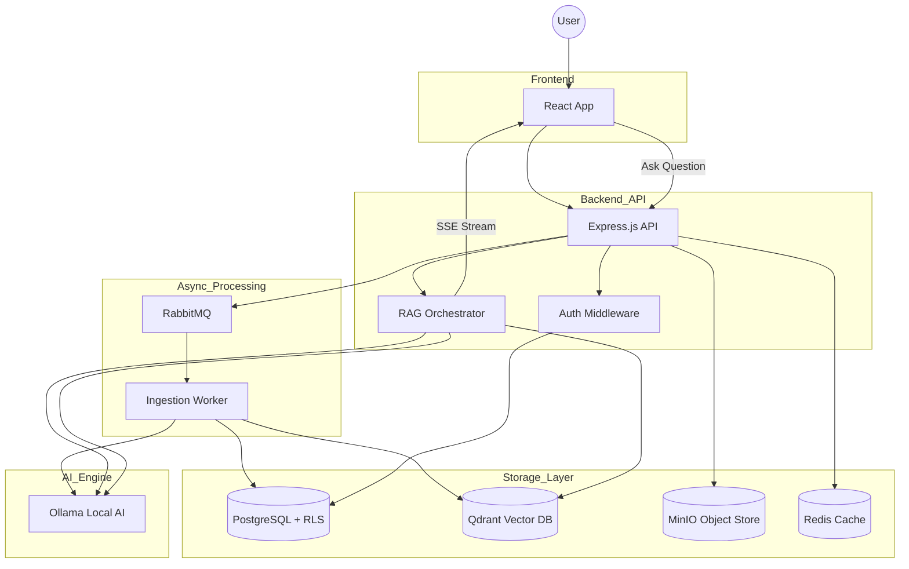

# Project Analysis: Multi-Tenant RAG Document Q&A Platform

## 1. Problem Statement
The platform solves the need for multiple organizations to have their own **private, isolated knowledge bases**. It allows companies to upload internal documents and use an AI to answer questions based *only* on those documents. The core problem is providing the power of an LLM while ensuring **strict data isolation**—preventing Company A from ever seeing Company B's data.

## 2. Complete System Overview
The system is a multi-tenant web application. It consists of:
- **Frontend**: A React interface for managing documents and chatting.
- **Backend**: A Node.js/Express API that orchestrates authentication, document management, and RAG.
- **Async Pipeline**: RabbitMQ and workers that handle the heavy lifting of processing documents.
- **Storage Layer**:
    - **MinIO** for raw files.
    - **PostgreSQL** for structured metadata and user/tenant management.
    - **Qdrant** for vector embeddings of document chunks.
- **AI Engine**: Ollama providing both the embedding model and the generative LLM locally.

## 3. RAG (Retrieval-Augmented Generation) in this Project
RAG is the technique of "augmenting" a Large Language Model's prompt with specific, retrieved data from a private source before asking the model to generate a response. Instead of relying on the LLM's general training data (which doesn't include private company docs), the system:
1. **Retrieves** the most relevant snippets of text from the tenant's documents.
2. **Augments** the prompt by adding these snippets as context.
3. **Generates** an answer based on that context.

## 4. Document Ingestion Workflow
1. **Upload**: User uploads a file (PDF, etc.) via the React frontend.
2. **Storage**: The API saves the original file to **MinIO**.
3. **Queueing**: The API creates a job in **RabbitMQ** and returns a "Processing" status to the user.
4. **Processing (Worker)**:
    - **Extraction**: Text is extracted from the file.
    - **Cleaning**: Text is normalized.
    - **Chunking**: Text is split into smaller, overlapping segments (chunks) to fit LLM context windows.
    - **Embedding**: Each chunk is sent to **Ollama (`nomic-embed-text`)** to be converted into a numerical vector.
5. **Indexing**:
    - **Vector Store**: Embeddings + `tenant_id` + `doc_id` are stored in **Qdrant**.
    - **Relational Store**: Document metadata and processing status are stored in **PostgreSQL**.

## 5. Question Answering Workflow
1. **Query**: User submits a question.
2. **Context Identification**: The system identifies the user's `tenant_id` via their session/token.
3. **Query Embedding**: The question is converted into a vector using **Ollama**.
4. **Filtered Retrieval**: **Qdrant** is searched for the most similar vectors, but **filtered strictly** by the `tenant_id`.
5. **Context Construction**: The retrieved text chunks are combined into a prompt (e.g., *"Using the following context: [Chunks], answer the question: [Question]"*).
6. **Generation**: The prompt is sent to the local LLM via **Ollama**.
7. **Streaming**: The response is streamed back to the frontend via **SSE**.
8. **Citations**: The system maps the retrieved chunks back to their original documents/pages.

## 6. Multi-tenancy Strategy
Multi-tenancy is implemented as **Logical Isolation** (shared infrastructure, separated data). Isolation is enforced at every layer:
- **Application Layer**: Middleware validates the user's organization membership on every request.
- **Database Layer**: PostgreSQL RLS ensures users only access rows belonging to their `tenant_id`.
- **Vector Layer**: Qdrant searches use a mandatory payload filter on `tenant_id`.
- **Storage Layer**: Files in MinIO are organized by tenant folders or metadata.
- **Processing Layer**: Background jobs carry the `tenant_id` to ensure data is written to the correct silos.

## 7. PostgreSQL Row-Level Security (RLS)
RLS is a database feature that allows us to define policies on tables. Instead of relying on `WHERE tenant_id = X` in every single API query (which is prone to developer error), RLS:
- Defines a policy: `USING (tenant_id = current_setting('app.current_tenant'))`.
- The backend sets the `app.current_tenant` variable for the session after authentication.
- The database automatically hides all rows that don't match the current tenant, making it mathematically impossible for a query to "leak" data from another tenant even if the developer forgets a `WHERE` clause.

## 8. Qdrant Tenant-Aware Search
Qdrant stores vectors along with "payloads" (metadata). To ensure isolation:
- Every single vector is stored with a `tenant_id` in its payload.
- Every search request includes a **Filter**.
- Example: `filter: { must: [ { key: "tenant_id", match: { value: "company_a" } } ] }`.
- This ensures the vector search engine ignores all vectors belonging to other companies before calculating similarity.

## 9. Comparison of Storage Components
| Component | Data Type | Purpose | Analogy |
|---|---|---|---|
| **MinIO** | Unstructured (Blobs) | Stores the original PDF/Doc files. | The Filing Cabinet (Physical Docs) |
| **PostgreSQL**| Structured (Relational) | Stores users, orgs, doc metadata, chat history. | The Ledger (Indexes & Rules) |
| **Qdrant** | Semi-structured (Vectors) | Stores mathematical representations of text. | The Brain (Semantic Meaning) |

## 10. Role of RabbitMQ
Document processing is "heavy": it involves file I/O, text extraction, multiple API calls to Ollama for embeddings, and database writes. If this happened in the request-response cycle, the API would timeout.
**RabbitMQ** decouples the upload from the processing:
- The API acknowledges the upload immediately.
- The Worker processes the file in the background.
- This provides scalability (we can add more workers) and reliability (failed jobs can be retried).

## 11. Ollama's Dual Role
Ollama acts as the local AI server:
1. **Embedding Model (`nomic-embed-text`)**: Converts text chunks and user questions into vectors. This is a "encoder" model—it doesn't talk; it just creates coordinates in a high-dimensional space.
2. **LLM (Inference)**: Takes the final RAG prompt and generates the natural language answer. This is a "decoder" model—it reads the context and writes a response.

## 12. Role of Redis
Redis provides high-performance, in-memory storage for:
- **Caching**: Storing frequently asked questions or common retrieval results to reduce LLM load.
- **Rate Limiting**: Ensuring a single tenant doesn't overwhelm the local LLM (which has limited GPU/CPU resources).
- **Session State**: Tracking temporary user states or socket identifiers.

## 13. SSE for Chat Interface
**Server-Sent Events (SSE)** allow the server to "push" data to the browser in a continuous stream.
Unlike traditional REST (where you wait for the whole answer) or WebSockets (which are full-duplex and heavier), SSE is perfect for LLMs because:
- It mimics the "typing" effect of ChatGPT.
- It reduces perceived latency (the user sees the first word immediately).
- It is lighter than WebSockets for one-way streaming.

## 14. Backend Component Responsibilities
- **API Gateway (Express)**: Auth, validation, tenant context establishment, orchestration.
- **Ingestion Worker**: PDF parsing, chunking, embedding generation, indexing.
- **RAG Orchestrator**: Question embedding, Qdrant retrieval, prompt engineering, Ollama communication.
- **Tenant Manager**: Handling organization creation, membership, and permissions.

## 15. End-to-End Data Flow

### Document Flow
`User` $\rightarrow$ `API` $\rightarrow$ `MinIO` $\rightarrow$ `RabbitMQ` $\rightarrow$ `Worker` $\rightarrow$ `Ollama (Embed)` $\rightarrow$ `Qdrant` & `Postgres`

### Query Flow
`User` $\rightarrow$ `API (Auth/Tenant Check)` $\rightarrow$ `Ollama (Embed Query)` $\rightarrow$ `Qdrant (Filtered Search)` $\rightarrow$ `Postgres (Metadata)` $\rightarrow$ `Ollama (LLM Gen)` $\rightarrow$ `SSE Stream` $\rightarrow$ `User`

## 16. Major Security Risks
1. **Cross-Tenant Leakage**: The biggest risk. Prevented by RLS and Qdrant filters.
2. **Prompt Injection**: Users trying to "trick" the LLM into ignoring the context or revealing system prompts.
3. **Unauthorized Uploads**: Users uploading malicious files or exceeding quotas.
4. **Resource Exhaustion**: A single tenant consuming all GPU resources for LLM inference (denial of service).

## 17. Major Technical Challenges
- **Chunking Strategy**: Finding the right chunk size and overlap to maintain semantic meaning without exceeding context windows.
- **Local LLM Latency**: Optimizing Ollama for acceptable response times on local hardware.
- **RLS Implementation**: Ensuring the tenant context is correctly passed from the Node.js app to the PostgreSQL session.
- **Citation Accuracy**: Precisely mapping a retrieved vector back to a specific page/section in the original PDF.

## 18. MVP vs. Advanced Functionality
| Feature | MVP (Initial) | Advanced (Future) |
|---|---|---|
| **Documents** | PDFs, Plain Text | Word, Excel, Scanned Images (OCR) |
| **Search** | Pure Vector Search | Hybrid Search (Keyword + Vector) |
| **Auth** | Simple JWT / Role-based | SSO, SAML, Complex Permission Trees |
| **LLM** | Single local model | Model routing (Small model for easy, Large for hard) |
| **RAG** | Basic Context Window | Re-ranking (Cross-encoders) for better precision |
| **Scaling** | Single-node Local | Distributed Workers, Qdrant Cluster |

## Architecture Diagram

